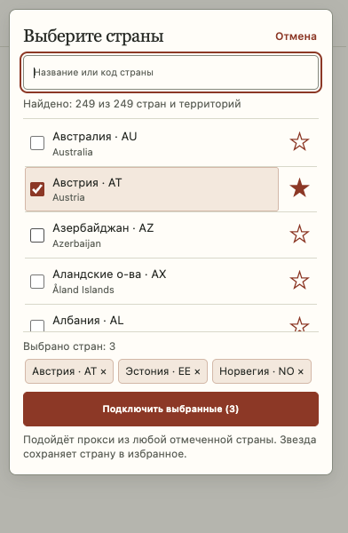

# Country Proxy

**Find and use public proxies from a country or an allowed set of countries in Chrome.**

Country Proxy discovers addresses, checks HTTPS and the exit country, confirms
the connection in Chrome, and replaces a failed proxy automatically. It is for
occasional public-web testing and country-routing experiments—for example,
checking your own public website through an available exit.

[Русское руководство](docs/README.ru.md) · [Getting started](docs/getting-started.md) ·
[Help](.github/SUPPORT.md) · [Security](.github/SECURITY.md) · [MIT License](LICENSE)

The interface is **Russian**; country search accepts Russian, English, and ISO
codes. The first stable targets **macOS and a regular Chrome profile**, with a
manual unpacked-extension install and a local **Python 3.11+** helper. Chrome
120+ is the code minimum; acceptance used Chrome for Testing 151 and Python
3.14 on macOS, not every version in that range. Linux has an installer but has
not passed the full browser acceptance. Windows and Incognito are unsupported.
There is no Chrome Web Store distribution or automatic update.

Published assets and release status: [GitHub Releases](https://github.com/Nelmad/country-proxy/releases).
Use the ZIP instructions below when the corresponding asset is available.
A source checkout or locally built ZIP is not itself a published release.

*Russian interface, disconnected example with the equal AT / EE / NO set.
Actual isolated-profile capture, 17 November 2026; not a public-availability result.*

## Before connecting

Use a separate Chrome profile without personal accounts for evaluation. Public
proxy operators are third parties: a successful HTTPS/country check does not
establish operator trust, anonymity, no logging, or access to every site.
Use a trusted connection for sensitive activity. Country Proxy changes the
chosen **browser profile**, not the system proxy; it is not an OS-wide VPN.

While searching, checking, or recovering, **new ordinary HTTP/HTTPS requests
across that profile are blocked**, including open tabs and localhost. Previously
sent traffic and existing connections cannot be recalled. Keep the recovery
steps below available before starting.

## Quick start

1. Install Python 3.11+ if needed. Download `country-proxy-X.Y.Z.zip` and its
   `.zip.sha256` from a published [release](https://github.com/Nelmad/country-proxy/releases),
   then [verify the checksum](docs/getting-started.md#install-on-macos).
   GitHub's automatic **Source code (zip)** is a different archive.
2. Extract the bundle to a **permanent folder** and run `Install.command` on
   macOS. It creates a local `.venv`, installs dependencies, and registers the
   Native Messaging helper. No always-open terminal is needed.
3. Open `chrome://extensions`, enable **Developer mode**, choose **Load unpacked**,
   and select `extension` from **the same bundle**. Both helper installation
   and extension loading are required.
4. Pin Country Proxy, open it, and choose a country. In **Несколько стран**
   (multiple countries), select a set and click **Подключить выбранные** (connect
   selected). Wait for **Подключено** (connected): the browser has confirmed the
   route. A country in the 249-entry catalog does not guarantee a live proxy.
5. When finished, click **Отключить** (Stop). If a page was blocked during the
   search, reload it after connecting; forms are not automatically resubmitted.

[Full English setup, status guide, update and rollback basics](docs/getting-started.md) ·
[Подробная установка на русском](docs/installation.md)

## Stop and restore your connection

Click **Отключить** (Stop). If cleanup needs another attempt, click
**Повторить отключение** (retry Stop). **Отключено** means Country Proxy has
released its own proxy, request-blocking, and privacy settings; another proxy
or system setting may still apply.

If the popup is unavailable, open `chrome://extensions` and **turn off Country
Proxy**. This suspends its request blocking and releases its Chrome settings;
removal is unnecessary. [Recovery and common problems](docs/getting-started.md#stop-and-recover)
also covers a missing helper and a connection that remains in search.

## What it does

- **An equal country set.** Select one country or an unordered group. Selection
  order gives no priority; a healthy connection stays in use rather than
  rotating on a timer. The chosen set and measured exit country are shown separately.
- **Checks in both parts.** The helper checks two certificate-validated HTTPS
  targets and Cloudflare GeoIP; Chrome then checks its own route. Supported
  transports: HTTP CONNECT, HTTPS proxy, SOCKS4, and SOCKS5.
- **Recovery and diagnostics.** Up to two reserves are prepared for the whole
  set. Failed candidates are temporarily skipped; source contribution and
  reserve diagnostics explain the current search. Search retries when no
  acceptable address is available.
- **Reusable selection.** Favorites and named country groups are stored
  locally. Group JSON export/import contains group names and countries.

Free public proxies are unreliable. There is no availability, speed, country
coverage, or recovery-time guarantee, and passing the two probe sites does not
promise that a particular destination will work. Discovery builds on
[proxy-scraper](https://github.com/maximilianfeix/proxy-scraper) and other
[public sources](docs/sources.md); see [third-party notices](NOTICE).

## Documentation and help

| Need | Read |
| --- | --- |
| Install, use, recover, or update (English) | [Getting started](docs/getting-started.md) |
| Detailed use / installation / troubleshooting (Russian) | [Guide](docs/README.ru.md) · [Installation](docs/installation.md) · [Runbook](docs/runbook.md) |
| Understand network calls, storage, and permissions | [Data and permissions](docs/getting-started.md#data-and-permissions) |
| Ask for help or report a bug | [Support](.github/SUPPORT.md) |
| Report a security concern | [Security policy](.github/SECURITY.md) |
| Develop or run checks | [Contributing](CONTRIBUTING.md) |
| Check evidence, scope, or changes | [Verification](docs/verification.md) · [Stable scope](docs/stable-readiness.md) · [Changelog](CHANGELOG.md) |

Most detailed engineering documentation is in Russian. Controlled test results
and observed public-proxy availability are recorded separately; neither is a
promise of public uptime.
